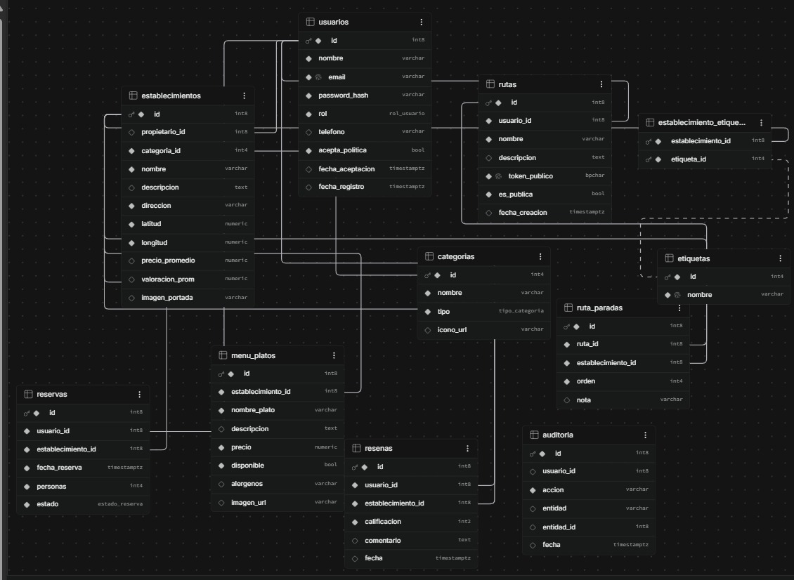

# Sabores & Rutas Santuario

Plataforma web de gastronomía y turismo de Santuario (Risaralda): catálogo de establecimientos, menús, reseñas, reservas y rutas, con base de datos PostgreSQL en **Supabase** y un **dashboard analítico en Looker Studio** incrustado en la vista principal.

## Enlaces

| Recurso | URL |
|---|---|
| Aplicación desplegada (frontend) |https://proyecto-rutas-y-sabores.vercel.app |
| API desplegada (backend) | https://proyecto-rutas-y-sabores.onrender.com/api/v1/establecimientos |
| URL base de la API | https://proyecto-rutas-y-sabores.onrender.com/api/v1|
| Dashboard Looker Studio | https://datastudio.google.com/embed/reporting/b51abdc1-caaa-49cb-8dcb-de1d16494fcc/page/qmtAG |
| Video demostrativo | _PEGAR_URL_VIDEO_ |

> Nota: el backend está en el plan gratuito de Render; la primera petición después de un rato de inactividad puede tardar hasta un minuto. 

## Arquitectura

```
React + Vite + TypeScript  ──HTTP──▶  Node + Express (JWT)  ──pg──▶  Supabase (PostgreSQL)
        │                                                                   ▲
        └── <iframe> Looker Studio ─────────── (usuario de solo lectura) ───┘
```

- **Frontend** (`sabores-rutas-frontend`): no se conecta a la base de datos; solo consume la API.
- **Backend** (`sabores-rutas-backend`): API REST bajo `/api/v1`, autenticación JWT, conexión a Supabase con la librería `pg`.
- **Base de datos**: PostgreSQL administrado por Supabase (11 tablas, 3 tipos ENUM).
- **BI**: Looker Studio conectado por el conector PostgreSQL con un rol de solo lectura.

## Ejecución local

### Requisitos
- Node.js 18 o superior
- Un proyecto de Supabase con el esquema cargado

### 1. Base de datos
1. En Supabase abre **SQL Editor**.
2. Ejecuta `sabores-rutas-backend/sql/schema.sql` (crea tipos, tablas e índices).
3. Ejecuta `sabores-rutas-backend/sql/seed.sql` (datos iniciales y ajuste de secuencias).

### 2. Backend
```bash
cd sabores-rutas-backend
npm install
cp .env.example .env     # en Windows: copy .env.example .env
# edita .env con tus valores
npm run dev
```
Debe mostrar `Servidor de Sabores & Rutas escuchando en http://localhost:3000` y `Conectado a Supabase`.

Variables de entorno del backend (ver `.env.example`):

| Variable | Descripción |
|---|---|
| `DATABASE_URL` | Cadena de conexión de Supabase (Session pooler, puerto 5432) |
| `JWT_SECRET` | Secreto para firmar los tokens |
| `FRONTEND_URL` | Origen permitido por CORS (local: `http://localhost:5173`) |
| `PORT` | Puerto del servidor (por defecto 3000) |

> Si tu `db.js` usa variables separadas (host, usuario, etc.), documenta aquí los nombres reales.

### 3. Frontend
```bash
cd sabores-rutas-frontend
npm install
cp .env.example .env
npm run dev
```
Abre `http://localhost:5173`.

| Variable | Valor local |
|---|---|
| `VITE_API_URL` | `http://localhost:3000/api/v1` |

### 4. Probar la persistencia
1. En el panel inferior de la web, crea una cuenta o inicia sesión.
2. Elige un lugar y una fecha y pulsa **Reservar**.
3. Verifica la nueva fila en Supabase → **Table Editor → reservas**.
4. Pulsa **Cancelar** y comprueba que el estado cambia a `CANCELADA`.

## Modelo de datos

Script de creación: [`sql/schema.sql`](sabores-rutas-backend/sql/schema.sql) · Script de población: [`sql/seed.sql`](sabores-rutas-backend/sql/seed.sql)

### Diagrama Entidad-Relación



### Integridad referencial
- `ON DELETE CASCADE`: menú, reseñas, reservas, rutas, paradas y etiquetas dependen de su entidad padre.
- `ON DELETE SET NULL`: `establecimientos.propietario_id` (el local sobrevive si se borra al dueño).
- Restricciones `CHECK`: calificación entre 1 y 5, personas mayor o igual a 1.
- Restricción `UNIQUE (usuario_id, establecimiento_id)` en reseñas: una reseña por usuario y lugar.
- Índices en claves foráneas y en coordenadas.

## Dashboard (Looker Studio)

- Fuente: conector **PostgreSQL** apuntando al Session pooler de Supabase, con un rol de solo lectura (`looker_ro`).
- Visualizaciones: tarjetas KPI (total de reservas, establecimientos, usuarios, personas), barras (reservas por establecimiento), circular (reservas por estado) y línea temporal (reservas por fecha).
- Filtros: control de **estado** y control de **rango de fechas**.
- Se incrusta en la vista principal con un `<iframe>` responsivo (`src/components/Dashboard.tsx`).

## Acceso a la base de datos

Los parámetros de conexión se entregan por el canal indicado por el docente y **no se publican en el repositorio**.

| Parámetro | Valor |
|---|---|
| Host (Session pooler) | `aws-0-REGION.pooler.supabase.com` |
| Puerto | `5432` |
| Base de datos | `postgres` |
| Usuario (solo lectura) | `looker_ro.PROJECT_REF` |
| Contraseña | _entregada por separado_ |

## Decisiones de diseño

- El backend se conecta con el rol `postgres` desde el servidor; la clave nunca llega al navegador.
- Las tablas tienen RLS activado sin políticas públicas, de modo que la API REST pública de Supabase no expone datos. Looker usa un rol con política de solo lectura.
- Los usuarios del seed tienen hashes de ejemplo; para iniciar sesión se debe registrar un usuario nuevo desde la web.
